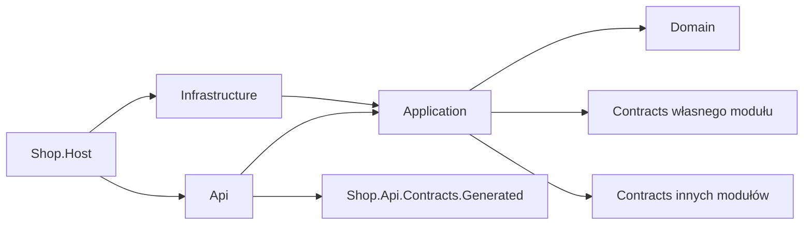
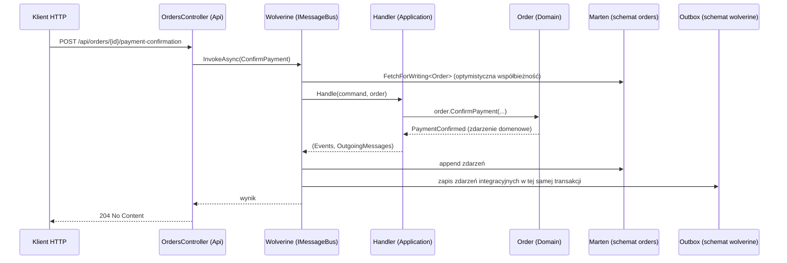
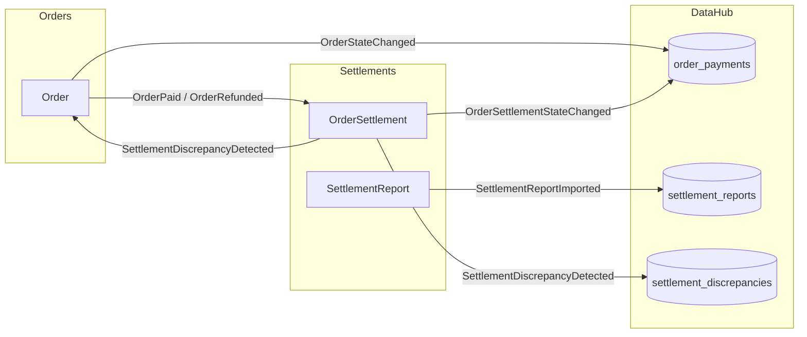

# Architektura POC „Shop”

Dokument opisuje docelowy kształt systemu. Jest źródłem prawdy dla ludzi i dla Claude.
Zmiana architektury = zmiana tego pliku + wpis w `docs/decisions.md`.

## 1. Domena w jednym akapicie

Sklep internetowy przyjmuje zamówienia i płatności przez fikcyjną bramkę **DemoPay**.
Bramka raz dziennie przysyła **raport rozliczeniowy** (CSV): które transakcje rozliczyła, z jaką prowizją
i jaką kwotą netto. Moduł Rozliczenia porównuje raport z tym, czego oczekiwał na podstawie zamówień,
i zgłasza **rozbieżności**. Moduł Zamówienia reaguje na rozbieżność, wstrzymując zwroty dla zamówienia.
**DataHub** skleja dane obu modułów w płaskie widoki do odczytu („co się dzieje z pieniędzmi za zamówienie X?”).

## 2. Moduły i schematy bazy

| Moduł | Rola | Persystencja | Schemat Postgres |
|---|---|---|---|
| Orders (Zamówienia) | zapis: cykl życia zamówienia i płatności | Marten, event sourcing, osobny store `IOrdersStore` | `orders` |
| Settlements (Rozliczenia) | zapis: oczekiwane transakcje, import raportów, uzgodnienia | Marten, event sourcing, osobny store `ISettlementsStore` | `settlements` |
| DataHub | odczyt: płaskie widoki sklejone z obu modułów | EF Core, `DataHubDbContext` | `datahub` |
| (infrastruktura) | trwałe kolejki, inbox/outbox Wolverine | Wolverine message storage | `wolverine` |

Jedna fizyczna baza `shop`. Brak kluczy obcych między schematami różnych modułów.

## 3. Warstwy (architektura heksagonalna)

Każdy moduł zapisu składa się z projektów:

```
Shop.<Moduł>.Contracts       zdarzenia integracyjne – publiczne API modułu dla innych modułów
Shop.<Moduł>.Domain          agregaty, zdarzenia domenowe, reguły (czysty C#)
Shop.<Moduł>.Application     przypadki użycia: handlery Wolverine, walidatory, mapowanie na zdarzenia integracyjne
Shop.<Moduł>.Infrastructure  wyłącznie rejestracja: Marten store, rozszerzenie Wolverine, DI
Shop.<Moduł>.Migrations      skrypty SQL dla Flyway (Sql/), nic więcej
Shop.<Moduł>.Api             kontrolery implementujące wygenerowany kontrakt OpenAPI
```

Kierunek zależności (strzałka = „może referencjonować”):



* **Domain** nie zna Martena, Wolverine, EF ani ASP.NET. Jedyny wyjątek techniczny: analizator
  (source generator) Martena 9 musi działać w assembly z agregatem – patrz `docs/decisions.md` D-009.
* **Application** może używać Wolverine (atrybuty, `OutgoingMessages`), Martena (`IDocumentSession`,
  `IQuerySession`) w modułach zapisu i EF Core w DataHub. To świadomy wybór: logika jest w Application
  i Domain, a nie rozsmarowana po adapterach.
* **Infrastructure** zawiera tylko konfigurację i rejestrację. Jeśli w Infrastructure pojawia się `if`
  związany z biznesem – to błąd.
* **Api** mapuje żądanie HTTP na komendę/zapytanie, wywołuje `IMessageBus.InvokeAsync`, mapuje wynik na odpowiedź.
  Bez logiki, bez dostępu do bazy.

DataHub ma projekty `Application` (widoki, `DataHubDbContext`, handlery projekcji, zapytania), `Infrastructure`,
`Migrations` (migracje EF + Sql/) i `Api`. Nie ma `Domain` ani `Contracts` – nie podejmuje decyzji biznesowych
i nie publikuje zdarzeń (decyzja D-008).

Wspólne projekty:

```
src/Host/Shop.Host                     ASP.NET Core – kompozycja modułów, uwierzytelnianie, ProblemDetails, Wolverine
src/Host/Shop.AppHost                  Aspire – Postgres, Keycloak, Flyway, Host, GUI
src/Host/Shop.ServiceDefaults          Aspire service defaults (OpenTelemetry, health checks)
src/Shared/Shop.SharedKernel           minimalne typy wspólne (wyjątki reguł biznesowych) – bez zależności
src/Shared/Shop.Messaging.Migrations   Sql/ dla schematu wolverine
src/Api/Shop.Api.Contracts.Generated   KOD GENEROWANY z api/openapi/shop-api.yaml – nie edytować
src/Gui/Shop.Gui                       Blazor Server + MudBlazor
src/Gui/Shop.Api.Client.Generated      KOD GENEROWANY – klient HTTP dla GUI – nie edytować
```

## 4. Przepływ komendy (zapis)



Zasada: **jedna transakcja = zdarzenia domenowe + zdarzenia integracyjne w outboxie**. Nic nie wychodzi z modułu,
jeśli zapis się nie powiódł.

## 5. Komunikacja między modułami

* Wyłącznie asynchronicznie, przez trwałe lokalne kolejki Wolverine (`UseDurableLocalQueues`) z inbox/outbox
  w PostgreSQL. Bez RabbitMQ na etapie POC.
* `MultipleHandlerBehavior.Separated` – każdy handler danego zdarzenia ma własną kolejkę, transakcję i ponawianie.
* `MessageStorageSchemaName = "wolverine"` – wspólne tabele inbox/outbox dla wszystkich modułów.
* Zdarzenia integracyjne to rekordy w `Shop.<Moduł>.Contracts`, nazwy z sufiksem `IntegrationEvent`.
  Zdarzenia domenowe nigdy nie opuszczają modułu.

Dwa rodzaje zdarzeń integracyjnych:

| Rodzaj | Przykład | Odbiorca | Zawartość |
|---|---|---|---|
| **Fakt biznesowy** | `OrderPaidIntegrationEvent` | inne moduły zapisu (reakcje biznesowe), DataHub (widoki dziennika) | to, co się stało, + identyfikatory |
| **Zmiana stanu** | `OrderStateChangedIntegrationEvent` | DataHub (widoki stanu) | pełny stan potrzebny do odczytu + `Version` strumienia |

Mapa przepływów:



## 6. DataHub – jak skleja dane

**Widok stanu** (np. `order_payments`, jeden wiersz na zamówienie):

* każdy moduł źródłowy „posiada” swoje kolumny i swoją kolumnę wersji (`orders_version`, `settlement_version`);
* handler: wczytaj wiersz (lub utwórz) → jeśli `event.Version <= wersja_źródła` pomiń (duplikat lub stare) →
  nadpisz swoje kolumny → przelicz **status złożony** czystą funkcją z obu połówek → zapisz;
* wiersz ma token współbieżności (`xmin`); konflikt zapisu → Wolverine ponawia handler, który ponownie wczytuje wiersz.

Dzięki temu kolejność dostarczenia zdarzeń nie ma znaczenia, a duplikaty są nieszkodliwe.

**Widok dziennika** (np. `settlement_discrepancies`): wstawienie wiersza z unikalnym identyfikatorem zdarzenia
biznesowego; jeśli istnieje – pomiń.

**Zapytania**: proste zapytania LINQ po płaskich tabelach, stronicowanie, filtry. Złączenia tylko w obrębie
schematu `datahub`.

## 7. Baza danych i migracje

* Jedynym wykonawcą zmian schematu jest **Flyway** – osobna historia (`flyway_schema_history`) w schemacie każdego modułu.
* Aplikacja startuje z `AutoCreate.None` (Marten i Wolverine) i nigdy nie modyfikuje schematu.
* Źródła SQL:
  * Marten (orders, settlements) i Wolverine (wolverine) – generator Weasel: `dotnet run -- db-patch` dla wybranej bazy;
  * DataHub – migracje EF Core zamienione na SQL (`dotnet ef migrations script`).
* Lista modułów migracji jest w jednym miejscu: `db/flyway-modules.json` (czyta ją AppHost, testy integracyjne i CI).
* Poprawność: test integracyjny stawia bazę wyłącznie przez Flyway, a potem sprawdza, że konfiguracja Martena,
  Wolverine i model EF **nie mają różnic** względem bazy (odpowiednik `db-assert` + brak oczekujących zmian modelu EF).

## 8. Bezpieczeństwo

* Keycloak (kontener w Aspire, realm `shop` importowany z pliku). Docelowo w firmie: Keycloak + Active Directory.
* API: JWT Bearer, audience `shop-api`. Role realmu → polityki:

| Rola | Uprawnienia |
|---|---|
| `sales` | składanie, anulowanie, zwroty zamówień; odczyt `order-payments` |
| `gateway` | potwierdzenie płatności (symulacja callbacku DemoPay) |
| `accounting` | import raportów rozliczeniowych; odczyt wszystkich widoków DataHub |

* GUI: OIDC (authorization code), token przekazywany do API.
* Testy integracyjne: stub uwierzytelniania (Alba), bez Keycloaka.

## 9. Kontrakt API (contract-first)

* Źródło prawdy: `api/openapi/shop-api.yaml` (OpenAPI 3.0.3). Właściciel: ludzie.
* Docelowo w firmie: pipeline generuje kod (openapi-generator) i publikuje paczkę do Artifactory.
  W POC symuluje to `scripts/api/generate-contracts.sh` (generator `aspnetcore`, `buildTarget=library`,
  abstrakcyjne kontrolery) – wynik w `src/Api/Shop.Api.Contracts.Generated`.
* Moduły implementują abstrakcyjne kontrolery w swoich projektach `*.Api`.
* Błędy: `application/problem+json` (ProblemDetails) z polem `code`.

| Sytuacja | Status |
|---|---|
| walidacja wejścia (FluentValidation) | 400 + `errors` |
| brak zasobu | 404 |
| konflikt współbieżności / duplikat (np. raport już zaimportowany) | 409 |
| naruszenie reguły biznesowej | 422 + `code`, np. `orders.payment-amount-mismatch` |
