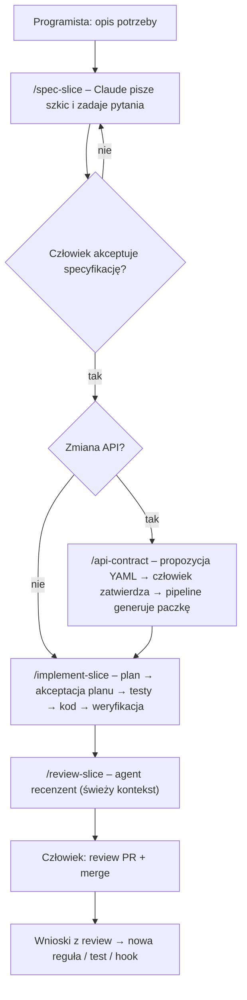

# Jak pracujemy z Claude Code

Dokument dla zespołu. Opisuje system pracy: co robi człowiek, co robi Claude, gdzie są reguły i jak je rozwijamy.

## 1. Zasada główna

**Claude pisze kod, człowiek odpowiada za zmianę.** Każda zmiana przechodzi przez specyfikację zaakceptowaną przez
człowieka i przez review w PR. Claude przyspiesza drogę od decyzji do działającego, przetestowanego kodu;
nie podejmuje za nas decyzji biznesowych ani architektonicznych.

## 2. Elementy systemu

| Element | Gdzie | Do czego | Kto zmienia |
|---|---|---|---|
| Instrukcje projektu | `CLAUDE.md` | kontekst, polecenia, zasady nienegocjowalne – ładowane w każdej sesji | zespół przez PR |
| Reguły warstw | `.claude/rules/*.md` | standardy Domain/Application/Api/…; ładują się, gdy Claude dotyka plików danej warstwy | zespół przez PR |
| Kontekst modułu | `src/Modules/<Moduł>/CLAUDE.md` | język domeny, agregaty, zdarzenia, reguły | aktualizuje Claude przy zmianie modelu, review człowiek |
| Specyfikacje | `docs/specs/NNN-*.md` | „co” i „dlaczego” dla jednego slice'a, kryteria akceptacji, przykłady | szkic Claude, akceptacja człowiek |
| Skille | `.claude/skills/*/SKILL.md` | powtarzalne procedury: `/spec-slice`, `/api-contract`, `/implement-slice`, `/review-slice`, `db-migration`, `datahub-view` | zespół przez PR |
| Agent recenzent | `.claude/agents/slice-reviewer.md` | niezależny przegląd zmian względem specyfikacji i standardów | zespół przez PR |
| Uprawnienia i hooki | `.claude/settings.json`, `.claude/hooks/` | twarde blokady: kod generowany, zastosowane migracje, `git push` | zespół przez PR |
| Testy architektury | `tests/Shop.ArchitectureTests` | automatyczne pilnowanie zależności i nazw – działa też w CI | zespół |

Reguła kciuka: **instrukcja w markdown to prośba, hook i test to gwarancja.** To, co musi być zawsze prawdą,
przenosimy do testu architektury, hooka albo uprawnień.

## 3. Cykl pracy nad slice'em

Punkty kontrolne człowieka (Claude zatrzymuje się i czeka):
1. akceptacja specyfikacji (status „Zaakceptowana”),
2. akceptacja kontraktu API,
3. akceptacja planu implementacji,
4. review PR – w tym przegląd SQL migracji.

## 4. Jak dobrze zlecać

* **Jedno zadanie = jedna sesja.** Po zakończeniu slice'a `/clear`. Długa sesja z wieloma tematami pogarsza jakość.
* **Najpierw plan.** W rozszerzeniu VS Code włącz tryb planowania przed większą zmianą; poprawiaj plan, nie kod.
* **Wskazuj kontekst.** `@ścieżka/do/pliku` zamiast „ten handler od płatności”.
* **Podawaj przykłady z liczbami.** „Dla zamówienia 199,99 zł i prowizji 2,80 zł netto to 197,19 zł” jest lepsze niż „policz netto”.
* **Mów, czego nie robić.** „Bez zmian w kontrakcie API”, „bez nowych pakietów”.
* **Korzystaj z checkpointów.** Jeśli Claude poszedł w złą stronę – cofnij do checkpointu i doprecyzuj polecenie,
  zamiast łatać kolejnymi poleceniami.

## 5. Review zmian przygotowanych przez Claude

Checklist człowieka (agent recenzent robi pierwszy przebieg, ale nie zastępuje człowieka):

- [ ] Zmiana robi to, co mówi specyfikacja – i nic więcej.
- [ ] Każde AC ma test, a testy sprawdzają zachowanie (nie implementację).
- [ ] Reguły biznesowe są w Domain, nazwane i skomentowane.
- [ ] Api i Infrastructure są cienkie.
- [ ] SQL migracji przejrzany – brak niezamierzonych `DROP`.
- [ ] Zdarzenia integracyjne: kompatybilność wsteczna, dokumentacja XML.
- [ ] Kod jest czytelny dla osoby spoza zadania.

## 6. Pętla doskonalenia

Każdy komentarz z review, który powtarza się drugi raz, zamieniamy na:

1. **test architektury lub hook** – jeśli da się to sprawdzić automatycznie,
2. **regułę w `.claude/rules/`** – jeśli to konwencja,
3. **przykład w skillu** – jeśli to procedura.

Zmiany w `.claude/` i `CLAUDE.md` przechodzą przez PR jak kod. `CLAUDE.md` trzymamy krótki (< 200 linii) –
szczegóły idą do reguł z `paths` i do skilli.

## 7. Czego Claude nie robi bez zgody

* nie pushuje, nie merguje, nie zmienia gałęzi chronionych,
* nie edytuje kodu generowanego i zastosowanych migracji (blokada techniczna),
* nie dodaje pakietów i nie zmienia wersji,
* nie wyłącza testów ani ostrzeżeń,
* nie zmienia kontraktu API ani zdarzeń integracyjnych poza tym, co jest w zaakceptowanej specyfikacji.

## 8. Metryki pilotażu

Zbieramy przez 4–6 tygodni, żeby decyzja o szerszym wdrożeniu opierała się na danych:

| Metryka | Jak mierzymy |
|---|---|
| Czas od zaakceptowanej specyfikacji do PR | daty w specyfikacji i PR |
| Liczba iteracji review na PR | komentarze w PR |
| Odsetek komentarzy „niezgodne ze standardem” | etykieta w review – powinien spadać, bo zamieniamy je w reguły |
| Błędy znalezione po merge | zgłoszenia powiązane z PR |
| Subiektywna ocena zespołu | krótka ankieta co 2 tygodnie |
